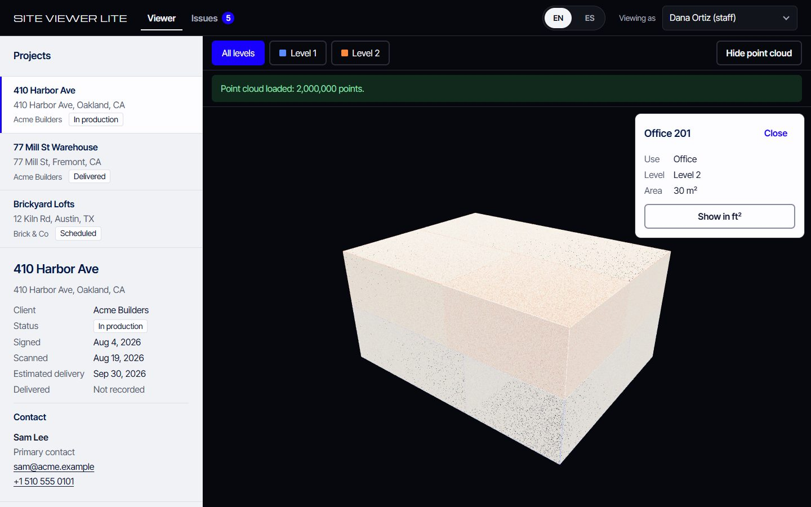
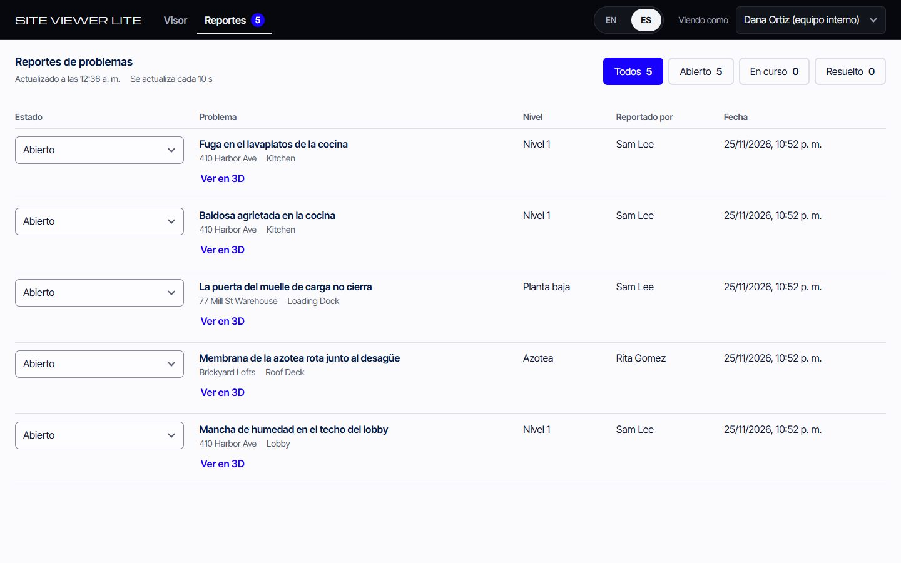
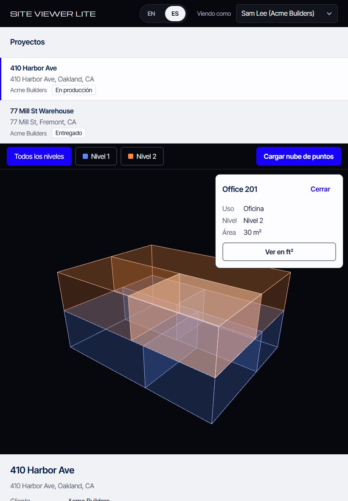
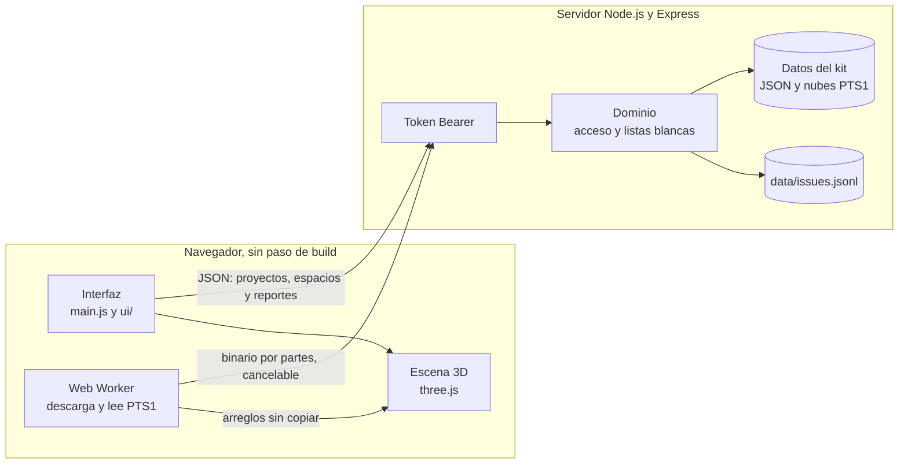
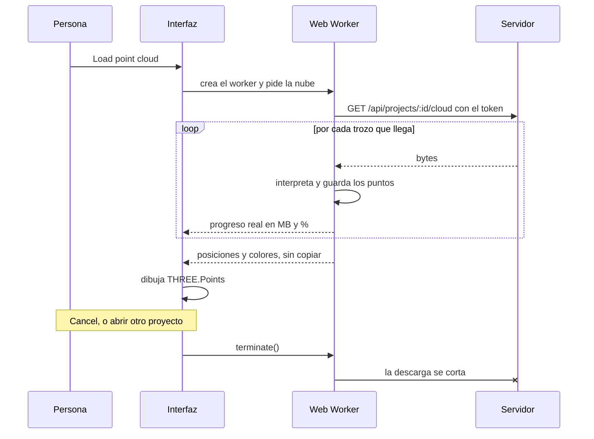

# Site Viewer Lite

API en Node.js y visor web con three.js para revisar edificios escaneados. Cada persona elige un proyecto, ve sus espacios en 3D, carga la nube de puntos y reporta problemas. Un cliente solo ve sus proyectos y nunca recibe datos internos.

[](https://site-viewer-lite.onrender.com)




## Contenido

- [Probar en línea](#probar-en-línea)
- [Probar en local, paso a paso](#probar-en-local-paso-a-paso)
- [Recorrido guiado](#recorrido-guiado)
- [Qué cubre del enunciado](#qué-cubre-del-enunciado)
- [Extras](#extras)
- [Arquitectura](#arquitectura)
- [API](#api)
- [Pruebas](#pruebas)
- [Decisiones](#decisiones)
- [Estructura](#estructura)
- [Qué falta y qué haría con un día más](#qué-falta-y-qué-haría-con-un-día-más)
- [Formato PTS1](#formato-pts1)
- [Declaración sobre uso de asistentes de IA](#declaración-sobre-uso-de-asistentes-de-ia)

## Probar en línea

**<https://site-viewer-lite.onrender.com>**

No necesita instalar nada. Si la primera carga tarda unos segundos, el servidor se está despertando.

| Usuario | Token | Qué ve |
|---|---|---|
| Dana Ortiz | `staff-token` | Staff: los tres proyectos, correo y teléfono de los contactos, y el panel de reportes |
| Sam Lee | `acme-token` | Cliente Acme Builders: solo *410 Harbor Ave* y *77 Mill St Warehouse* |
| Rita Gomez | `brick-token` | Cliente Brick & Co: solo *Brickyard Lofts*, que no tiene nube (sirve para ver el 404) |

## Probar en local, paso a paso

### Requisitos

- **Node.js 18 o superior.** Para comprobarlo, en una terminal: `node -v`. Si no está instalado, se descarga en [nodejs.org](https://nodejs.org).
- **Git**, para clonar el repositorio.
- **Opcional:** Google Chrome, solo para las pruebas automáticas en navegador.

No hace falta base de datos, Docker ni variables de entorno.

### 1. Clonar el repositorio

```bash
git clone https://github.com/Jhorguen/Prueba-t-cnica-Full-Stack-3D-.git
cd Prueba-t-cnica-Full-Stack-3D-
```

### 2. Instalar y arrancar con un solo comando

```bash
npm run quickstart
```

Este comando hace, en orden:

1. **`npm install`:** instala las dependencias (Express, three.js y dos fuentes tipográficas).
2. **Genera las nubes de puntos de ejemplo** en `data/clouds/` con el generador del kit: 2 000 000 de puntos para *410 Harbor Ave* (unos 30 MB) y 400 000 para *77 Mill St Warehouse*. Tarda unos segundos y solo ocurre la primera vez.
3. **Arranca el servidor**, que sirve a la vez la página y la API.

Está listo cuando la terminal muestra:

```
Site Viewer Lite running at http://localhost:3000
```

### 3. Abrir el visor

Abre **<http://localhost:3000>** en el navegador y elige un usuario en **Viewing as** (los de la tabla de arriba).

### Comandos útiles

| Comando | Qué hace |
|---|---|
| `npm run quickstart` | Instala, genera las nubes y arranca. Para la primera vez |
| `npm start` | Arranca sin reinstalar. Genera las nubes solo si faltan |
| `npm test` | Corre las 78 pruebas de la API y del visor |
| `npm run test:e2e` | Corre las 18 pruebas en navegador (necesita Chrome) |
| `npm run clouds:truncate` | Reemplaza la nube de *410 Harbor Ave* por una cortada al 60 %, para ver el error de archivo incompleto |
| `npm run clouds` | Vuelve a generar las nubes completas |

Para detener el servidor: <kbd>Ctrl</kbd> + <kbd>C</kbd> en la terminal.

### Si algo no funciona

- **El puerto 3000 está ocupado:** arranca en otro puerto. En macOS o Linux: `PORT=4000 npm start`. En Windows PowerShell: `$env:PORT=4000; npm start`. Luego abre `http://localhost:4000`.
- **`node` no se reconoce como comando:** Node.js no está instalado o la terminal se abrió antes de instalarlo. Instálalo y abre una terminal nueva.

### Probar desde un iPad en la misma red

1. Averigua la IP del computador: en Windows con `ipconfig` (dirección IPv4); en macOS con `ipconfig getifaddr en0`.
2. En Safari del iPad abre `http://<ip-del-computador>:3000`, por ejemplo `http://192.168.1.20:3000`.
3. Si Windows pregunta por el firewall al arrancar, permite Node.js en redes privadas.

## Recorrido guiado

1. **Elige quién eres.** En **Viewing as**, prueba con Sam Lee: solo ve sus dos proyectos. Con Dana Ortiz ves los tres, y además el correo y el teléfono de los contactos.
2. **Abre un proyecto.** La ficha muestra cliente, estado y fechas; las que faltan dicen *Not recorded*.
3. **Explora en 3D.** Cada cuarto es una caja con un color por nivel.
   - Orbitar: arrastrar con el mouse o un dedo.
   - Desplazar: clic derecho o dos dedos.
   - Zoom: rueda del mouse o pellizcar.
   - Al tocar una caja, un panel muestra nombre, uso, nivel y área, con un botón para pasar de m² a ft².
   - Los chips de arriba muestran un solo nivel; también recortan la nube a esa altura.
4. **Carga la nube.** En *410 Harbor Ave*, pulsa **Load point cloud**. Verás el progreso real en MB y porcentaje, y un botón **Cancel**. Al orbitar, la nube se ve un poco menos densa y al soltar vuelve completa.
5. **Cambia de proyecto a mitad de carga.** Mientras avanza la barra, abre otro proyecto: la descarga se corta y ningún punto del anterior aparece en el nuevo.
6. **Provoca errores.** Cada uno muestra un mensaje claro con **Try again**:
   - *Brickyard Lofts* no tiene nube: 404.
   - Archivo cortado: en local, `npm run clouds:truncate` y carga la nube de *410 Harbor Ave*.
   - Sin conexión: en las herramientas del navegador (F12, Network), activa *Offline* y carga la nube.
7. **Reporta un problema.** Toca una caja, escribe un título y pulsa **Submit issue**. El formulario muestra el ID del reporte, o los errores por campo si algo falta.
8. **Revisa los reportes como staff.** Con Dana Ortiz aparece la pestaña **Issues**. Los reportes nuevos llegan solos, se puede cambiar su estado, y **Open in 3D** lleva al espacio del reporte.
9. **Cambia de idioma.** El selector **EN / ES** traduce todo lo que hay en pantalla sin perder lo que estabas viendo.

## Qué cubre del enunciado

### Parte A: API

| Regla | Cómo se cumple | Prueba |
|---|---|---|
| 1. Sin token o token inválido: 401 | Middleware de autenticación antes que cualquier otra cosa | `test/api/auth.test.js` |
| 2. `internal` nunca sale del servidor | Las respuestas se arman con listas blancas de campos | `test/api/privacy.test.js` |
| 3. El cliente no ve correo ni teléfono; el staff sí | El serializador decide por rol | `test/api/privacy.test.js` |
| 4. Un proyecto ajeno responde igual que uno inexistente | Mismo 404: estado, cuerpo y cabeceras | `test/api/access.test.js` |
| 5. Entradas malas: 4xx, nunca 500 | Validación de ids, cuerpos y JSON; título de 1 a 120 caracteres; nivel del proyecto | `test/api/validation.test.js` |
| 6. ETag y 304, sin cachés compartidas | ETag por cuerpo, `Cache-Control: private` y `Vary: Authorization` | `test/api/caching.test.js` |
| 7. `Range: bytes=0-15`: 206 con 16 bytes; sin nube: 404 | Envío de archivos con soporte de rangos | `test/api/cloud.test.js` |

### Parte B: visor

| Punto | Estado |
|---|---|
| 1. Selector de usuario, proyectos y ficha con *Not recorded* | ✅ |
| 2. Cajas por nivel, gestos con mouse y dedos, panel con m² y ft², filtro de nivel | ✅ |
| 3. Nube en un Web Worker con progreso real y Cancel, alineada con las cajas | ✅ |
| 4. Cambiar de proyecto cancela la descarga | ✅ Las pruebas comprueban en el servidor que la conexión se corta |
| 5. Archivo cortado, 404 y red caída con "Try again", sin excepciones en consola | ✅ |
| 6. Formulario de reporte sin `alert()` ni `prompt()` | ✅ |
| 7. iPad: controles de 44 px, sin scroll horizontal, sin zoom al tocar un campo | ✅ Verificado con emulación táctil a 1180×820 y 820×1180 |
| 2 millones de puntos fluidos | ✅ Ver "Rendimiento y reducción de puntos" en [Decisiones](#decisiones) |

### Parte C

Las cinco respuestas están en [`ANSWERS.md`](ANSWERS.md).

## Extras

Ninguno lo pide el enunciado. Están probados igual que el resto.

### Panel de reportes para el equipo interno



- Con el usuario staff aparece la pestaña **Issues**, con el número de reportes abiertos.
- Muestra todos los reportes de todas las cuentas: estado, problema, proyecto y espacio, nivel, quién y cuándo, con filtro por estado.
- Se actualiza sola cada 10 segundos y resalta los reportes que van llegando. Como la lista usa ETag, si no hay cambios el servidor responde 304 sin cuerpo.
- El estado (abierto, en curso, resuelto) se cambia desde la fila y queda registrado quién lo cambió.
- **Open in 3D** abre el proyecto, selecciona el espacio y acerca la cámara.
- El acceso se decide en el servidor: un cliente recibe 403 aunque llame a la API directamente.

### Español



- La página está en inglés, como pide el enunciado, y se cambia a español con el selector **EN / ES**. La elección se recuerda en el navegador. No se detecta el idioma del sistema, para que un navegador en español siga viendo la página en inglés por defecto.
- Al cambiar de idioma se redibuja todo lo que hay en pantalla sin perder el proyecto abierto ni la nube cargada.
- Fechas y números usan el formato regional: "4 de ago de 2026", "322,9 ft²", "2.000.000 puntos".
- Los niveles, usos y estados del kit se traducen solo en pantalla ("Level 2" se ve como "Nivel 2"); a la API se sigue enviando el valor original.

### Estilo visual

- Toma el lenguaje visual de mantislab.co, con valores medidos en su sitio: azul eléctrico `#1800FF` solo para la acción principal y la selección, superficies casi negras en la barra y el escenario 3D, títulos en azul marino `#001749` e Inter Tight en toda la interfaz. El nombre de la app usa Michroma, una fuente libre parecida a la de su marca. No se usa su logo ni su nombre.
- Animación de inicio inspirada en su preloader: dura 2 s, es solo CSS, deja pasar los toques y no se muestra si el sistema pide reducir movimiento.
- Todos los colores, fuentes y espacios son variables CSS; el visor 3D lee de ahí la paleta de niveles.
- Accesibilidad: foco visible en todo lo interactivo, contraste mínimo de 4,5:1 y menos movimiento cuando el sistema lo pide.

<br clear="right">

## Arquitectura



Cómo se carga y se cancela la nube:



## API

Todas las rutas exigen `Authorization: Bearer <token>`.

| Método y ruta | Respuesta |
|---|---|
| `GET /api/projects` | Proyectos visibles: `id`, `name`, `address`, `status`, `client.name` |
| `GET /api/projects/:id` | Lo anterior más `dates`, `levels` y `client.contacts` (correo y teléfono solo para staff) |
| `GET /api/projects/:id/spaces` | Espacios como cajas |
| `GET /api/projects/:id/cloud` | Binario PTS1 con soporte de `Range` |
| `POST /api/projects/:id/issues` | Crea `{ title, level, spaceId? }` y responde 201 con su `id` |
| `GET /api/me` | Nombre y rol de quien usa el token |
| `GET /api/issues` | Solo staff: todos los reportes, del más reciente al más antiguo. Con ETag |
| `PATCH /api/issues/:id` | Solo staff: cambia `{ status }` a `open`, `in_progress` o `resolved` |

Los errores siempre son JSON: `{ "error": { "code", "message", "details?" } }`.

| Caso | Estado |
|---|---|
| Sin token o token inválido | 401 |
| Id con formato inválido (no es `NNNN-NNNNN`) | 400 `invalid_id` |
| Proyecto inexistente o de otra cuenta | 404 `not_found`, idéntico en ambos casos |
| JSON roto | 400 `invalid_json` |
| Cuerpo inválido | 400 `validation_failed`, con `details` por campo |
| Cuerpo que no es `application/json` | 415 |
| Cuerpo mayor a 16 KB | 413 |
| Proyecto sin nube o archivo no generado | 404 `cloud_not_found` |
| Rango imposible | 416 |
| Un cliente pide el panel de reportes | 403 `forbidden` |
| Reporte inexistente | 404 `issue_not_found` |

## Pruebas

```bash
npm test
```

78 pruebas con `node:test` y `fetch` nativo, sin dependencias extra. Las de la API levantan la app en un puerto libre sobre una copia temporal de los datos. Las del visor importan los mismos módulos que usa el navegador.

| Archivo | Qué cubre |
|---|---|
| `test/api/auth.test.js` | Regla 1: sin token, token inválido o cabecera mal formada dan 401, también antes de leer el cuerpo |
| `test/api/privacy.test.js` | Reglas 2 y 3: ningún endpoint, para ningún usuario, devuelve `internal`; el cliente no recibe correo ni teléfono |
| `test/api/access.test.js` | Regla 4: un proyecto ajeno responde exactamente igual que uno inexistente, en todos los endpoints |
| `test/api/validation.test.js` | Regla 5: ids mal formados, JSON roto, cuerpos inválidos y límites del título dan 4xx, nunca 500 |
| `test/api/caching.test.js` | Regla 6: ETag, 304 con `If-None-Match`, `private` y `Vary: Authorization` |
| `test/api/cloud.test.js` | Regla 7: `Range: bytes=0-15` da 206 con 16 bytes; sin nube, 404; rango imposible, 416 |
| `test/api/issues.test.js` | Los reportes válidos se guardan con quién los creó; los rechazados no |
| `test/api/admin.test.js` | Panel de reportes: un cliente recibe 403; el staff ve todos, revalida con ETag y cambia estados; los cambios sobreviven a un reinicio |
| `test/web/pts.test.js` | Lector PTS1: trozos de cualquier tamaño, archivo cortado, formato inválido, muestra uniforme |
| `test/web/api-client.test.js` | Cliente de la API: errores tipados aunque el servidor responda HTML |
| `test/web/format.test.js` | *Not recorded*, fechas que no se corren un día, m² y ft² |
| `test/web/messages.test.js` | Mensajes de error y de progreso que ve la persona |
| `test/web/i18n.test.js` | Los diccionarios en inglés y español tienen las mismas claves; fechas, números y errores en español |

### Pruebas en navegador

```bash
npm run test:e2e
```

18 pruebas que abren el visor en Chrome sin ventana, con pantalla táctil y tamaño de iPad. Usan el Chrome instalado, sin descargar navegadores; con Edge: `E2E_BROWSER_CHANNEL=msedge npm run test:e2e`.

Entre el navegador y la app ponen un proxy que entrega la nube lentamente y registra si la conexión se cortó. Así comprueban que **Cancel** y cambiar de proyecto cortan la descarga de verdad en el servidor, no solo en pantalla. También cubren selección táctil, filtro de nivel, progreso, los tres errores con "Try again", el formulario, el panel de reportes, el cambio de idioma, las medidas de iPad en los dos idiomas y que no haya excepciones en consola.

## Decisiones

**Datos por cliente**
- Quién ve qué se decide en un solo lugar, `canViewProject` en `src/domain/access.js`, y se niega por defecto: un rol desconocido no ve nada.
- Las respuestas se arman con listas blancas de campos (`src/domain/serializers.js`), no borrando campos. Un campo nuevo en `projects.json` no sale del servidor hasta que alguien lo agrega a propósito.
- Orden de chequeo: token, formato del id, visibilidad del proyecto y, al final, el cuerpo. Así un cliente no puede distinguir un proyecto ajeno de uno inexistente, ni siquiera mandando JSON roto.
- Los tokens se buscan por su hash, para que el tiempo de respuesta no revele cuántos caracteres de un token adivinado coinciden.

**Caché**
- El ETag es un hash del cuerpo ya armado: staff y cliente reciben cuerpos distintos, así que también ETags distintos.
- `Cache-Control: private, no-cache` permite revalidar en el navegador pero no guardar en cachés compartidas, y `Vary: Authorization` separa por token. Los errores van con `no-store`.

**Carga 3D**
- El worker descarga e interpreta a la vez: lee el archivo por trozos y escribe directo en arreglos reservados de antemano. Nunca guarda el archivo completo en memoria, algo importante en iPad. Al terminar entrega los arreglos sin copiarlos.
- Cancelar es `worker.terminate()`, que corta también la descarga. Cada carga tiene su propio `AbortController`, y se ignora cualquier mensaje de una carga ya reemplazada.
- Un archivo cortado se detecta apenas llega el encabezado, comparando el tamaño que anuncia el servidor con el que anuncia el archivo, sin descargarlo todo para luego fallar.

**Rendimiento y reducción de puntos**
- La escena solo se dibuja cuando algo cambia, no 60 veces por segundo, y la densidad de píxeles se limita a 2×.
- Con la cámara quieta se dibujan los 2 millones de puntos. Mientras se orbita, desplaza o hace zoom se dibuja uno de cada cuatro, y al detenerse vuelve la nube completa. Para que esa muestra cubra todo el edificio, el lector guarda los puntos intercalados y basta con dibujar el primer cuarto. Medido: unas tres veces más cuadros por segundo al orbitar.
- Si un archivo trae más de 2 millones de puntos, el lector toma uno de cada N de forma uniforme y lo indica en pantalla.

**Front y servidor**
- Sin paso de build: three.js y las fuentes se instalan desde npm y las sirve el propio servidor. Funciona sin CDN y el código se puede modificar en vivo.
- En producción solo se usan Express, three.js y dos fuentes con licencia OFL. `playwright-core` se usa únicamente en las pruebas en navegador.
- Los reportes se agregan a `data/issues.jsonl`, sin reescribir el archivo: un cambio de estado agrega una versión nueva y al arrancar gana la última. Así un fallo no corrompe lo anterior, y una línea dañada se salta con un aviso en vez de impedir el arranque.
- Los textos de la interfaz viven en dos diccionarios, y una prueba falla si a uno le falta una clave del otro. Los errores se traducen por su código, no por el texto del servidor.

## Estructura

El servidor y el visor se organizan por capas, cada carpeta con una sola responsabilidad. El dominio y el almacenamiento no dependen de Express, así que se pueden probar solos.

```
src/                          servidor (API)
  server.js                   arranque
  app.js                      composición de Express y archivos estáticos
  middleware/                 token Bearer, errores en JSON, cuerpo JSON y ETag
  routes/
    projects.js               proyectos, espacios, nube y creación de reportes
    issues.js                 panel de reportes (solo staff)
  domain/
    access.js                 quién puede ver qué proyecto
    serializers.js            qué campos salen, según el rol
    validation.js             ids y cuerpos de las peticiones
  storage/
    data.js                   carga de los JSON del kit
    issues.js                 reportes en data/issues.jsonl

public/                       visor web, sin paso de build
  index.html, css/styles.css
  js/
    main.js                   estado de la página y flujo: usuario, proyecto, nube
    api/client.js             llamadas a la API con errores tipados
    scene/viewer.js           escena three.js: cajas, selección, filtro y nube
    cloud/                    worker, lector PTS1 y su control
    i18n/                     inglés y español
    ui/                       ficha, filtro, panel del espacio, formulario, panel de reportes

test/                         pruebas de la API y de los módulos del visor
e2e/                          pruebas en navegador
scripts/clouds.js             genera, regenera o corta las nubes
data/, tools/                 kit inicial, sin cambios
```

## Qué falta y qué haría con un día más

- **Probar en un iPad real con Safari** y medir los cuadros por segundo con una tarjeta gráfica real. Aquí se probó con Chrome y emulación táctil.
- **Nubes de cientos de MB:** un formato por bloques con menos detalle a lo lejos, y un tope de puntos según el dispositivo.
- **Reportes:** avisos por correo cuando llega uno, fotos desde el iPad, que el cliente vea el estado de los suyos y una base de datos real.
- **Robustez:** una clave anti-duplicados para que "Try again" tras una caída de red no cree dos reportes iguales, y un límite de peticiones por token.
- **Content-Security-Policy:** el import map necesita un hash en la política. No la activé porque no pude comprobar que Safari en iPad lo acepte, y si no lo acepta la página queda en blanco.

## Formato PTS1

Little-endian.

| Bytes | Tipo | Significado |
|---|---|---|
| 0–3 | ASCII | firma `PTS1` |
| 4–7 | uint32 | cantidad de puntos N |
| 8–11 | float32 | separación entre puntos en metros |
| 12–15 | uint32 | reservado |
| luego N × 16 | float32 x, y, z · uint8 r, g, b, intensidad | un punto |

Los espacios son cajas: `x, y, z` es la esquina mínima en metros (Z hacia arriba) y `w, d, h` el tamaño.

## Declaración sobre uso de asistentes de IA

En cumplimiento de las reglas de la prueba (*"Puedes usar asistentes de código. Di en el README cuáles usaste y para qué"*):

- **Herramienta utilizada:** Claude Code (Anthropic).
- **Usos específicos:**
  1. Escritura del código del servidor, del visor y de las pruebas automáticas.
  2. Verificación en navegador, con Chrome sin ventana y emulación de iPad, de la cancelación de la descarga, los errores y las medidas de los controles.
  3. Estilo visual: aplicación del lenguaje de mantislab.co y de las reglas de la guía de diseño [hallmark](https://github.com/nutlope/hallmark) para evitar patrones de interfaz genéricos.
  4. Redacción de esta documentación y borradores de las respuestas de la Parte C.
- **Mi parte:** definí el alcance y los extras (panel de reportes, español, estilo, despliegue), elegí entre las alternativas propuestas, revisé y ajusté una por una las respuestas de la Parte C y probé la aplicación.
